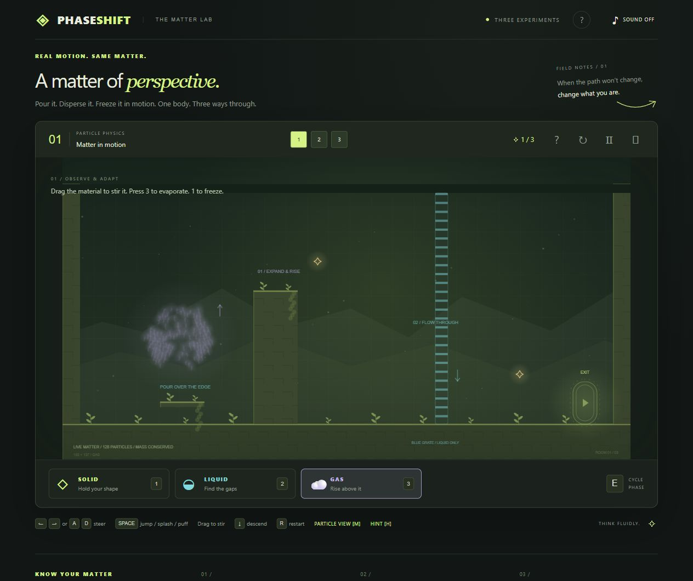

# Phase Shift

**[Play the browser demo](https://yum-yum-thighs.github.io/phase-shift/)** ·
**[How the prototype works](docs/CASE_STUDY.md)** ·
**[StickSlap, another prototype](https://yum-yum-thighs.github.io/stickslap/)**

Pour it. Disperse it. Freeze it in motion.

A three-room puzzle platformer in which the same 128 particles become liquid,
gas and ice. Every particle collides with the terrain; freezing captures the
material's actual shape. No account, API key, package installation or build step
is needed to play.



## Play

Reach the glowing exit. Collecting three sparks is optional.

| Control | Action |
| --- | --- |
| A / D or left / right | Steer |
| 1 / 2 / 3 | Solid / liquid / gas |
| E | Cycle phase |
| Space | Jump, slide, splash or puff |
| Drag the material | Pull and stir |
| Down / S | Descend as gas |
| R | Restart room |
| Escape | Pause/resume |
| H / hint button | Room hint |
| M | Inspect particles |

Touch buttons, instructions, optional synthesized audio and fullscreen are
included. Completion markers are saved in the browser. There is no timer or
failure penalty. Reduced-motion preferences are respected.

## Run locally

Requires Node.js 20 or newer:

```sh
npm start
```

Open the printed address, normally http://127.0.0.1:4173. JavaScript modules need
HTTP, so use this server rather than opening the HTML as a local file.

```sh
npm test
```

Tests cover the actual physics, complete routes through all three rooms and
pointer mapping through fullscreen/phone layouts. See [verification](verification/README.md)
for browser checks and remaining limits.

## Source and hosting

Read [the case study](docs/CASE_STUDY.md) for the simulation, rendering and control
flow. All runtime paths are relative, so the root folder can be hosted beneath a
website subdirectory. GitHub Pages serves `main` from `/`; `.nojekyll` keeps the
site buildless. To embed it on another site:

```html
<iframe src="https://yum-yum-thighs.github.io/phase-shift/"
        title="Phase Shift game" width="100%" height="900"
        allow="fullscreen" loading="lazy"></iframe>
```

## Attribution and scope

An AI-assisted gameplay prototype by [yum-yum-thighs](https://github.com/yum-yum-thighs).
The concept, creative direction and iteration requests came from the creator;
implementation and review used substantial AI assistance. The source and tests
are provided for portfolio inspection. See [CREDITS.md](CREDITS.md).

The particle model is a game approximation, rather than a thermodynamic or
engineering solver. Physical phone hardware and a broader device range still
need testing.
